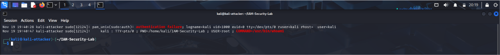
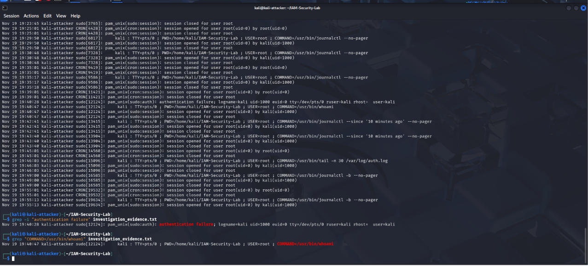
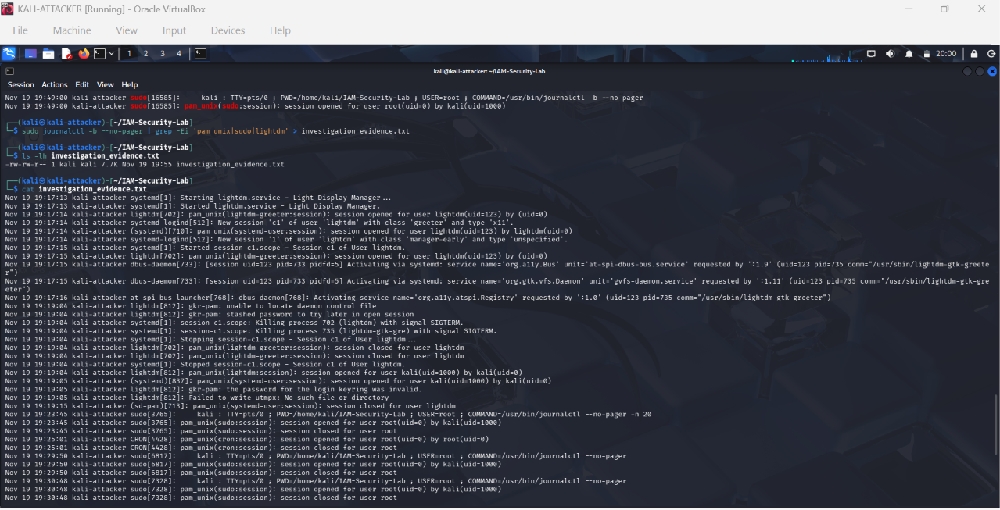

# IAM Security Investigation Lab

This personal lab documents how I investigated a failed Linux `sudo` authentication attempt and correlated it with a subsequent command run as `root`. I generated the activity in an authorized Kali Linux lab running in Oracle VirtualBox.

**Case IAM-001 · Informational · Authorized lab activity**

## Environment and tools

| Component | Role in the investigation |
| --- | --- |
| Kali Linux and Oracle VirtualBox | Lab VM hosting the local account and its authentication logs |
| Linux PAM, `sudo`, and LightDM | Sources of authentication, privileged command, and session events |
| systemd journal, `journalctl`, and `grep` | Queried, filtered, and exported relevant log records |
| Git and GitHub | Versioned the report and supporting evidence |

## Investigation method

1. Reviewed recent journal entries and searched for authentication failures. An initial search surfaced a LightDM login failure, which was kept outside the `sudo` case timeline.
2. Generated a failed `sudo` authentication by entering an incorrect password, then successfully ran `whoami` through `sudo`.
3. Exported a filtered copy of the current boot's journal and searched it for the PAM failure and the `whoami` command record.
4. Correlated the records using the VM hostname, account, `sudo` process ID, terminal, and timestamps. Checked the surrounding session events for context.

## Findings

| Nov 19, 2026 · VM local time | Observation |
| --- | --- |
| 19:40:28 | `pam_unix(sudo:auth)` recorded an authentication failure for `kali`. |
| 19:40:47 | `sudo` recorded `/usr/bin/whoami` with target user `root`. The surrounding log shows the root session opening and closing. |

Both records were associated with `sudo[12124]` on `kali-attacker` and terminal `pts/0`. The 19-second gap and matching fields tie the events to the same `sudo` process. The activity matched the authorized test, and the reviewed evidence showed no unauthorized access.

[Incident report](incident_report.md) · [Original log excerpt](evidence/authentication_events.txt)

## Screenshot evidence

### Failed authentication and privileged command

### Validation against the exported journal

### Evidence collection

[LightDM authentication export](screenshots/04-lightdm-authentication-export.png) · [Authentication keyword search](screenshots/05-authentication-keyword-search.png) · [Initial journal review](screenshots/06-initial-journal-review.png)

## Skills demonstrated

- **IAM and identity security** — Interpreted authentication failures and distinguished the initiating account from the privileged target user.
- **Security operations** — Triaged authentication events and correlated records across timestamps, process IDs, and terminal fields.
- **Evidence handling** — Exported and validated relevant journal records and documented a scoped disposition.
